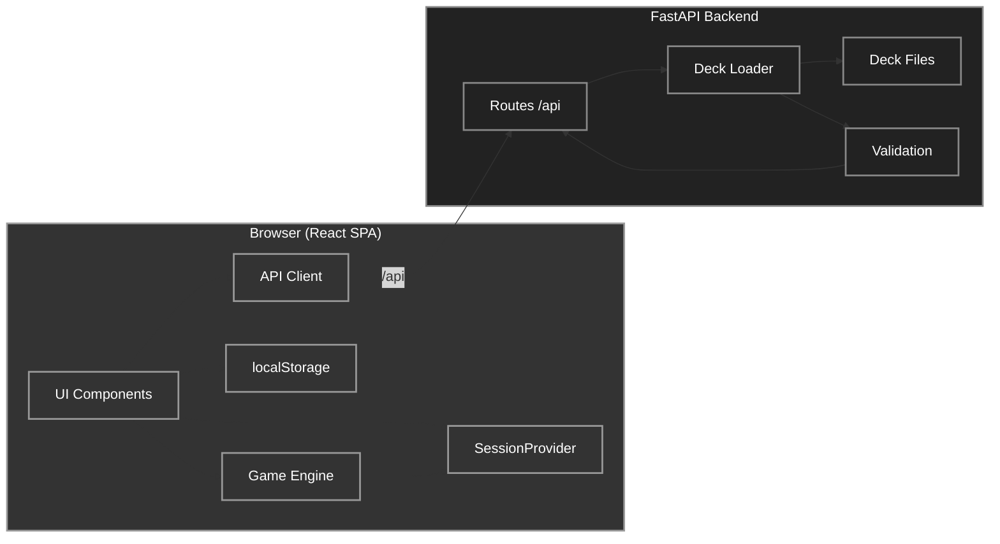
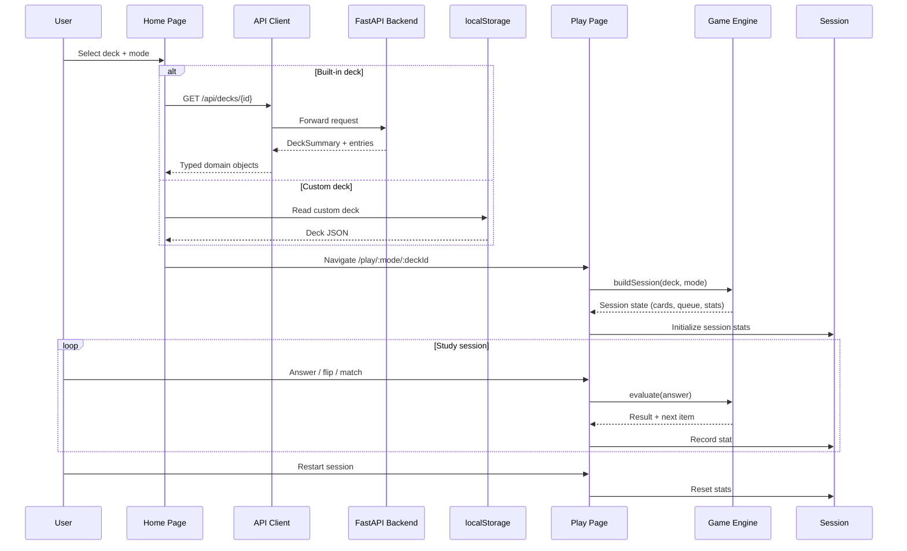
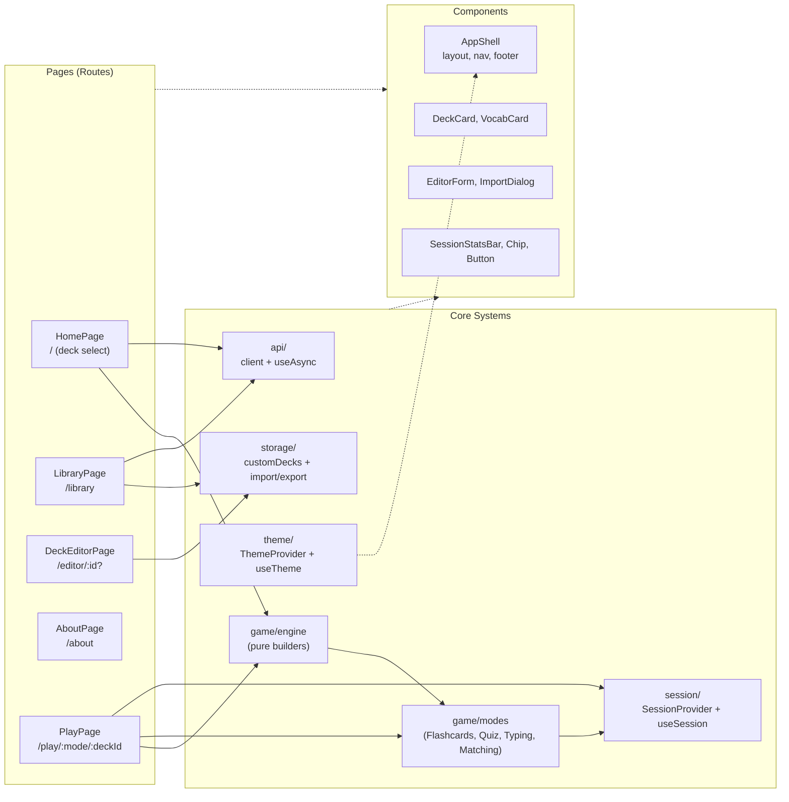
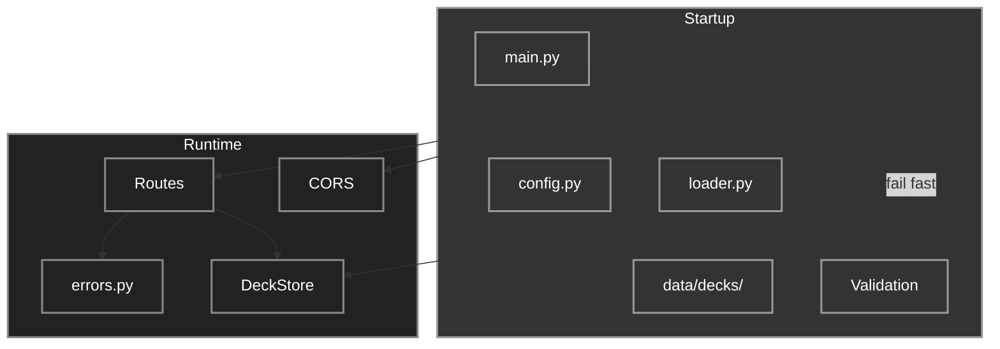

# Vocab Deck


**Vocab Deck** is a vocabulary practice application that helps language learners memorize words through four interactive study modes. It provides a modern React frontend backed by a FastAPI vocabulary service. Built-in decks cover English→French, English→German, and English→Japanese; users can also create, edit, import, and export custom decks entirely in the browser.


## Features

- **Four study modes**: Flashcards (with 3D flip), Multiple-choice Quiz, Typing (accent-insensitive option), Matching
- **Three built-in language pairs**: English→French, English→German, English→Japanese (50 entries each, directly comparable)
- **Custom decks**: Create, edit, import (JSON/CSV), export; validated client-side with same rules as built-in decks
- **Session tracking**: Per-mode stats (correct/incorrect, streaks, time) preserved across mode switches; reset on demand
- **Theme support**: Light/dark with `prefers-color-scheme` detection and `localStorage` persistence, no flash on load
- **Accessibility**: `prefers-reduced-motion` swaps flip for instant face swap; focus-visible outlines; semantic HTML
- **Offline-capable custom decks**: Stored in `localStorage`, portable via JSON/CSV export
- **Typed API contract**: Shared TypeScript/Pydantic schemas; frontend client maps DTOs to domain types

---

## How It Works

### Execution Flow

1. **Input:** User selects a deck (built-in or custom) and a study mode on the Home page
2. **Validation:** Frontend resolves the deck. Built-in decks fetched from `/api/decks/{id}`, custom decks read from `localStorage`; entries validated against shared schema
3. **Processing:** Game engine (pure functions) builds a randomized session for the chosen mode:
   - Flashcards: sequential with flip timer
   - Quiz: generates 3 distractors per question, excludes alternatives
   - Typing: NFC/case/whitespace-insensitive comparison, optional accent folding
   - Matching: builds a bipartite pairing, drops ambiguous translations
4. **Storage / external services:**
   - Built-in decks: read from `backend/app/data/decks/` at backend startup
   - Custom decks: `localStorage` (key `flash-card-game.customDecks.v1`)
   - Theme preference: `localStorage` (key `vocabdeck.theme`)
   - Gameplay progress: **memory only** (React context), discarded on reload
5. **Output:** Interactive UI with real-time feedback (correct/incorrect animations, stats bar)

### Key Design Decisions

| Decision | Trade-off |
|---|---|
| Backend is vocabulary-only, no gameplay endpoints | Simpler API, no auth/session mgmt; frontend owns all game logic |
| Progress in memory only | Zero server cost, privacy-friendly; but reload loses session |
| Custom decks in `localStorage` | Portable, offline, no backend storage; but per-browser, no sync |
| Static deck files in git | Version-controlled, diffable, zero infra; but redeploy to add decks |
| Four modes share one engine | Consistent randomization, stats, text rules; more upfront design |

---

## Architecture

### System Architecture



### Data Flow



### Frontend Architecture



### Backend Architecture



---

## Tech Stack

| Technology | Purpose |
|---|---|
| **Python 3.11+** | Backend runtime |
| **FastAPI 0.110+** | Web framework, automatic OpenAPI, validation |
| **Uvicorn** | ASGI server |
| **Pydantic 2** | Settings, schemas, validation |
| **Node.js 18+** | Frontend runtime |
| **React 18 + TypeScript** | SPA framework |
| **Vite** | Dev server, build, proxy |
| **Vitest + Testing Library** | Unit/component tests |
| **Playwright** | End-to-end tests |
| **ESLint + TypeScript** | Linting, type-checking |
| **CSS Custom Properties** | Design tokens, theming, no build-time CSS framework |

- No database deck files are the source of truth, loaded at startup

---

## Codebase Structure

```text
Vocab-Deck/
├── backend/                     # FastAPI vocabulary service
│   ├── app/
│   │   ├── main.py              # App factory, routes, CORS, error handlers
│   │   ├── config.py            # Pydantic settings (CORS_ORIGINS, APP_ENV)
│   │   ├── schemas.py           # API contract (Pydantic models)
│   │   ├── loader.py            # Deck discovery + validation (JSON, CSV+meta)
│   │   ├── errors.py            # Domain errors → HTTP error JSON
│   │   └── data/decks/          # Version-controlled built-in decks
│   │       ├── en-de.json       # English → German (50 entries)
│   │       ├── en-fr.json       # English → French (50 entries)
│   │       └── en-ja.json       # English → Japanese (50 entries)
│   ├── tests/                   # pytest + FastAPI TestClient (83 tests)
│   └── pyproject.toml
├── frontend/                    # React + TypeScript + Vite SPA
│   ├── e2e/                     # Playwright E2E tests (25 tests)
│   ├── src/
│   │   ├── api/                 # Typed client + useAsync hook
│   │   ├── game/                # Engine (rng, text rules) + 4 modes
│   │   ├── session/             # In-memory session stats + restart
│   │   ├── storage/             # Custom decks in localStorage
│   │   ├── theme/               # Light/dark theme provider
│   │   ├── components/          # Shell, nav, footer, cards, buttons, toggle
│   │   ├── pages/               # Home, Library, Editor, About, Play
│   │   └── styles/              # tokens → global → components → motion
│   ├── playwright.config.ts
│   ├── vite.config.ts           # Dev/preview proxy to backend
│   └── package.json
├── .gitignore
└── README.md
```

### Key Directories

| Path | Responsibility | Where to Contribute |
|---|---|---|
| `backend/app/loader.py` | Deck loading, validation, ID derivation | Add deck formats, fix validation |
| `backend/app/schemas.py` | API request/response models | Change API contract |
| `frontend/src/game/engine.ts` | Pure session builders, randomization | Modify game logic, add modes |
| `frontend/src/game/modes/` | Mode-specific UI + evaluation | Tweak mode behavior, feedback |
| `frontend/src/storage/customDecks.ts` | localStorage CRUD, import/export | Custom deck features |
| `frontend/src/styles/tokens.css` | Design tokens (colors, spacing, type) | Visual changes |

---

## Getting Started

### Prerequisites

- **Python 3.11+** with `pip`
- **Node.js 18+** with `npm`
- (Optional) `make` for convenience commands

### Installation

```bash
# Clone
git clone https://github.com/PIYUSH-NEXTGEN/Vocab-Deck.git
cd Vocab-Deck

# Backend
cd backend
python -m venv .venv
# Windows:
.venv\Scripts\activate
# macOS/Linux:
source .venv/bin/activate
pip install fastapi uvicorn pydantic

# Frontend
cd ../frontend
npm install
```

### Configuration

| Variable | Where | Default | Description |
|---|---|---|---|
| `CORS_ORIGINS` | Backend | `http://localhost:5173,http://127.0.0.1:5173` | Comma-separated origins allowed to call API; `*` allows all |
| `APP_ENV` | Backend | `development` | Informational only |
| `VITE_API_TARGET` | Frontend (dev/preview) | `http://127.0.0.1:8000` | Proxy target for `/api` in dev |
| `VITE_API_URL` | Frontend (all) | `/api` | Absolute API base; bypasses proxy when set |

Create `.env` files if you need non-default values (e.g., backend on another port):

```bash
# backend/.env
CORS_ORIGINS=http://localhost:5173,http://127.0.0.1:5173

# frontend/.env
VITE_API_TARGET=http://127.0.0.1:8000
```

### Run Locally

**Terminal 1 (Backend):**
```bash
cd backend
uvicorn app.main:app --reload --port 8000
# → http://127.0.0.1:8000/api/health  {"status":"ok","deck_count":3}
```

**Terminal 2 (Frontend):**
```bash
cd frontend
npm run dev
# → http://localhost:5173  (proxies /api to :8000)
```

Open http://localhost:5173 and select a deck, choose a mode, start studying.


## Usage

### Home Page (`/`)
- Choose a built-in deck (en-fr, en-de, en-ja) or a custom deck
- Select study mode: Flashcards, Quiz, Typing, Matching
- Click **Play** to start

### Library (`/library`)
- **Built-in decks**: read-only, view entries
- **Custom decks**: create new, edit, delete, export (JSON/CSV), import
- Import: drag-and-drop or click to select `.json`/`.csv`; preview validates before confirm

### Editor (`/editor` or `/editor/:id`)
- Name, description, source/target language names (e.g., `english`, `hindi`, `french`)
- Entry grid: add/edit/remove rows; alternatives and tags as comma-separated values
- Save writes to `localStorage`; deck ID is stable on edit

### Play (`/play/:mode/:deckId`)
- **Flashcards**: space/click to flip, ←/→ or buttons to navigate, self-assess (✅/❌)
- **Quiz**: click option, immediate feedback, next auto-advances
- **Typing**: type answer, Enter to submit; toggle "Ignore accents" for kana/umlauts
- **Matching**: drag to pair source↔target; ambiguous translations dropped with notice
- **Session bar**: shows correct/incorrect/streak per mode; **Restart session** resets


---
## Configuration Reference

| Variable | Required | Default | Description |
|---|---|---|---|
| `CORS_ORIGINS` | No | `http://localhost:5173,http://127.0.0.1:5173` | Backend: allowed browser origins |
| `APP_ENV` | No | `development` | Backend: informational |
| `VITE_API_TARGET` | No | `http://127.0.0.1:8000` | Frontend dev/preview: proxy target |
| `VITE_API_URL` | No | `/api` | Frontend: absolute API base (bypasses proxy) |

---

## Testing

| Command | Scope |
|---|---|
| `cd backend && python -m pytest` | Backend API, schemas, loader, built-in decks (83 tests) |
| `cd frontend && npm run typecheck` | TypeScript `tsc --noEmit` |
| `cd frontend && npm run lint` | ESLint |
| `cd frontend && npm test` | Vitest unit/component (183 tests) |
| `cd frontend && npm run test:e2e` | Playwright E2E (27 tests: all modes, 3 lang pairs, custom decks, import/export, responsive, theme, caching, about-page anchors) |
| `cd frontend && npm run build` | Production build (typecheck + vite) |

The Playwright config starts the backend on port 8010 and a preview build on 4173 automatically. Install browsers once: `npx playwright install chromium`.

---

## Performance

Verified on the committed tree (Windows, Python 3.14, Node 24):

| Check | Result |
|---|---|
| Backend tests | **84 passed** |
| Frontend unit/component tests | **183 passed** (19 files) |
| TypeScript type-check | clean |
| ESLint | clean |
| Production build | **succeeded** (29.8 kB CSS, 366 kB JS / 116 kB gzip) |
| Playwright E2E | **27 passed** |

- Backend loads ~3 decks (75 entries) at startup, under 50 ms cold start
- Frontend bundle: 363 kB JS (116 kB gzip), 27.6 kB CSS
- No runtime performance benchmarks measured; the app is lightweight by design

---

## Security

- **Authentication/Authorization:** None. Intentional. No user accounts, no sensitive data.
- **CORS:** Configured via `CORS_ORIGINS`; explicit origins only (never `*` with credentials).
- **Input Validation:** Pydantic on backend (startup + runtime), Zod-equivalent client-side validation for custom decks.
- **Secret Management:** No secrets in code. No API keys required.
- **Rate Limiting:** Not implemented (low-risk public vocabulary API).
- **Content Security Policy:** Not configured; static host should add one.
- **Vulnerability Reporting:** Open an issue or email the maintainer privately.


---

## Contributing

1. Fork the repo
2. Create a feature branch: `git checkout -b feat/your-feature`
3. Run checks locally:
   ```bash
   cd backend && python -m pytest
   cd ../frontend && npm run typecheck && npm run lint && npm test && npm run build
   ```
4. Commit with conventional messages: `feat:`, `fix:`, `chore:`, `docs:`, `refactor:`
5. Open a PR with a clear description and screenshots for UI changes
